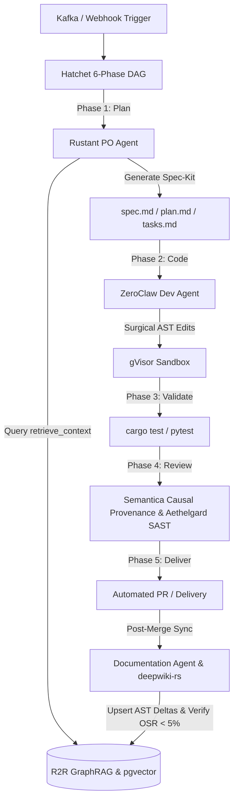

<h3 align="center">
The most advanced AI retrieval system.

Agentic Retrieval-Augmented Generation (RAG) with a RESTful API.
</h3>

<div align="center">
   <div>
      <a href="https://r2r-docs.sciphi.ai/"><strong>Docs</strong></a> ·
      <a href="https://github.com/SciPhi-AI/R2R/issues/new?assignees=&labels=&projects=&template=bug_report.md&title="><strong>Report Bug</strong></a> ·
      <a href="https://github.com/SciPhi-AI/R2R/issues/new?assignees=&labels=&projects=&template=feature_request.md&title="><strong>Feature Request</strong></a> ·
      <a href="https://discord.gg/p6KqD2kjtB"><strong>Discord</strong></a>
   </div>
   <br />
   <p align="center">
    <a href="https://r2r-docs.sciphi.ai"></a>
    <a href="https://discord.gg/p6KqD2kjtB"></a>
    <a href="https://github.com/SciPhi-AI"></a>
    <a href="https://github.com/SciPhi-AI/R2R/pulse"></a>
    <a href="https://opensource.org/licenses/MIT"></a>
  </p>
</div>

# About
R2R is an advanced AI retrieval system supporting Retrieval-Augmented Generation (RAG) with production-ready features. Built around a RESTful API, R2R offers multimodal content ingestion, hybrid search, knowledge graphs, and comprehensive document management.

R2R also includes a **Deep Research API**, a multi-step reasoning system that fetches relevant data from your knowledgebase and/or the internet to deliver richer, context-aware answers for complex queries.

---

## 🏭 Dark Gravity Autonomous CA/CD Factory Integration

In the **Dark Gravity Autonomous CA/CD Software Factory (V7.2 / V7.3)**, **R2R (Rag-to-Riches / R2R GraphRAG)** serves as the living **Semantic Corporate Memory**. It eliminates "documentary amnesia" and prompt context bloat by maintaining a persistent, queryable vector and topological representation of the entire evolving codebase.

<p align="center">
  
</p>

### 📐 System Architecture & Cluster Topology

* **Service Deployment**: Deployed as a high-availability microservice in the `llm-apps` Kubernetes namespace (`r2r.llm-apps.svc.cluster.local:7272`), protected by OpenZiti zero-trust overlay network sidecars and OAuth2-Proxy / Nginx authentication layers.
* **CloudNativePG & `pgvector` Storage**: Backed by a high-availability CloudNativePG PostgreSQL 16 cluster (`mlflow-db`) in the `storage` namespace running the `pgvector` extension.
* **Read-Replica Query Scaling**: Vector similarity searches are automatically routed to CloudNativePG read replicas (`mlflow-db-ro` via `r2r-read-replica-service`), preventing lock contention and reserving primary instances for Hatchet workflow engine transactions.
* **Rust Workspace Client**: Native asynchronous client implemented in `crates/factory-infrastructure/src/r2r.rs` (`HttpR2rClient` / `R2rClient`) supporting JWT authentication, vector similarity searches, atomic upserts, and telemetry metrics.

---

### ⚡ lgcorzo Features & Enhancements

#### 1. AST Delta Processing (`deepwiki-rs`)
Whenever code merges occur, `deepwiki-rs` (a native Rust Tree-sitter AST parser) extracts syntax tree deltas and symbol dependency relationships (`depends_on`). These AST deltas are converted into vector embeddings and upserted into R2R's `pgvector` store without requiring full repository re-indexing.

#### 2. Three-Level Context Pruning Engine
To eliminate prompt context bloat and optimize LLM token efficiency, R2R integrates with the `retrieve_context` MCP tool (`factory-mcp-server/src/skills/context.rs`) using a 3-tier filtering pipeline:

<p align="center">
  
</p>

1. **Semantic Filtering**: Discards matches with a cosine similarity distance below a strict quality threshold.
2. **Structural Pruning**: Traverses the AST dependency graph to prune out nodes that do not fall on the direct execution/dependency path of the target Git diff.
3. **Token Budget Clamping**: Truncates and formats the remaining context to fit within strict LLM buffer limits, preventing prompt overflow and runaway inference spend.

#### 3. Orphan Symbol Rate (OSR) Telemetry Gate
`R2rClient` implements `push_osr_metric()`, which tracks documentation drift across merges. It computes the ratio of compiled AST code symbols versus symbols documented in Wiki pages, enforcing an **OSR < 5%** quality gate before allowing automated documentation commits.

#### 4. Open Knowledge Format (OKF) Ingestion
R2R natively ingests documentation formatted according to the **Open Knowledge Format (OKF)** specification:
* Parses YAML frontmatter metadata (`type`, `mission_id`, `tags`, `source_path`) directly into `pgvector` metadata columns.
* Enables hybrid retrieval combining geometric vector similarity with deterministic SQL metadata filters (e.g. `WHERE type = 'architecture' AND tags IN ('database')`).

---

### 🔄 Multi-Agent Integration & Use Cases



| Agent / Subsystem | Interaction Pattern | Key Benefit |
| :--- | :--- | :--- |
| **Product Owner (Rustant)** | Queries `R2rClient::search()` during `/speckit-specify` and `/speckit-plan` | Grounds task specifications in real codebase symbols and avoids hallucinating legacy interfaces. |
| **Developer (ZeroClaw)** | Queries R2R AST subgraphs before applying surgical find-and-replace patches | Ensures localized code edits inside gVisor sandboxes (≤ 30 MiB RAM) without loading whole repos into memory. |
| **Documentation Agent** | Ingests AST deltas via `deepwiki-rs` and verifies `OSR < 5%` | Prevents documentation drift; guarantees Wiki models stay 100% in sync with code in `main`. |
| **QA Observer Daemon** | Polls Sentry crash events every 15 min and vector searches stacktraces | Automatically maps production stacktraces to the exact source files and triggers automated hotfix workflows. |
| **LiteLLM Gateway** | Routes pruned prompts with FinOps Virtual Tags (`FinOpsTag`) | Prevents context overflow and attributes inference costs directly back to specific Epics and missions. |
| **Semantica-AGI** | Dual-memory overlay: R2R (geometric similarity) + Semantica (causal lineage) | Combines statistical semantic recall with deterministic causal provenance via Kafka `agent-thought`. |

---

# Usage

```python
# Basic search
results = client.retrieval.search(query="What is DeepSeek R1?")

# RAG with citations
response = client.retrieval.rag(query="What is DeepSeek R1?")

# Deep Research RAG Agent
response = client.retrieval.agent(
  message={"role":"user", "content": "What does deepseek r1 imply? Think about market, societal implications, and more."},
  rag_generation_config={
    "model": "anthropic/claude-3-7-sonnet-20250219",
    "extended_thinking": True,
    "thinking_budget": 4096,
    "temperature": 1,
    "top_p": None,
    "max_tokens_to_sample": 16000,
  },
)
```


## Getting Started
```bash
# Quick install and run in light mode
pip install r2r
export OPENAI_API_KEY=sk-...
python -m r2r.serve

# Or run in full mode with Docker
# git clone git@github.com:SciPhi-AI/R2R.git && cd R2R
# export R2R_CONFIG_NAME=full OPENAI_API_KEY=sk-...
# docker compose -f compose.full.yaml --profile postgres up -d
```

For detailed self-hosting instructions, see the [self-hosting docs](https://r2r-docs.sciphi.ai/self-hosting/installation/overview).

## Demo
https://github.com/user-attachments/assets/173f7a1f-7c0b-4055-b667-e2cdcf70128b

## Using the API

### 1. Install SDK & Setup

```bash
# Install SDK
pip install r2r  # Python
# or
npm i r2r-js    # JavaScript
```

### 2. Client Initialization

```python
from r2r import R2RClient
client = R2RClient(base_url="http://localhost:7272")
```

```javascript
const { r2rClient } = require('r2r-js');
const client = new r2rClient("http://localhost:7272");
```

### 3. Document Operations

```python
# Ingest sample or your own document
client.documents.create(file_path="/path/to/file")

# List documents
client.documents.list()
```


## Key Features

- **📁 Multimodal Ingestion**: Parse `.txt`, `.pdf`, `.json`, `.png`, `.mp3`, and more
- **🔍 Hybrid Search**: Semantic + keyword search with reciprocal rank fusion
- **🔗 Knowledge Graphs**: Automatic entity & relationship extraction
- **🤖 Agentic RAG**: Reasoning agent integrated with retrieval
- **🔐 User & Access Management**: Complete authentication & collection system

## Community & Contributing

- [Join our Discord](https://discord.gg/p6KqD2kjtB) for support and discussion
- Submit [feature requests](https://github.com/SciPhi-AI/R2R/issues/new?assignees=&labels=&projects=&template=feature_request.md&title=) or [bug reports](https://github.com/SciPhi-AI/R2R/issues/new?assignees=&labels=&projects=&template=bug_report.md&title=)
- Open PRs for new features, improvements, or documentation

